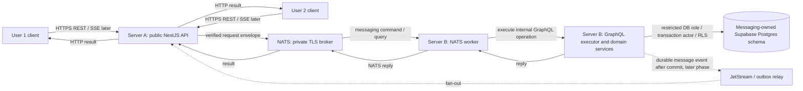

# Standalone messaging monorepo: microservice architecture and POC plan

## Goal and scope

This is a **separate Git monorepo**, independent of `ClinicalWebApp`. It contains independently deployed NestJS services, shared internal contracts, its own infrastructure configuration, and its own migrations. The plan below also describes later phases beyond the initial runnable POC.

The product is a doctor–patient messaging backend. Clients talk to **Server A** through REST (and, when live delivery is added, a connection to A). **Server B** owns the new messaging business rules and PostgreSQL access and exposes a GraphQL domain contract internally. A and B exchange requests and replies through **NATS**. The existing ClinicalWebApp Supabase project supplies user identities and stores messages. The current POC permits a patient and their currently assigned doctor to share a conversation. The clinical application's existing messaging path still uses its own REST/Data API and Realtime integration during this POC.

## Proposed new repository layout

```text
messaging-platform/                 # separate Git repository
  apps/
    api-gateway/                    # Server A: public REST, Auth, validation, SSE later
    messaging-service/              # Server B: NATS worker, GraphQL, domain, DB access
    event-relay/                    # later: transactional outbox to JetStream
  packages/
    contracts/                      # versioned NATS envelopes, DTO schemas, error codes
    observability/                  # shared trace and correlation conventions
  supabase/migrations/              # messaging-owned Postgres schema and RLS
  infra/nats/                       # TLS, service identities, subject ACLs
  compose.yaml                      # local A, B, NATS, and test dependencies
  package.json                      # workspace scripts
  pnpm-workspace.yaml               # or one equivalent workspace manager
  README.md
```

Each app builds and deploys separately. Shared packages contain contracts and small cross-cutting utilities, **not** database repositories or domain services. The new `conversations` table is used by B and the compatibility trigger; `public.messages` remains shared with the existing clinical app. A and B verify JWTs from that same Supabase Auth project. The Data API and Realtime stay enabled because the clinical application uses them; preserve its authenticated-user grants and RLS policies. B connects with a new restricted `messaging_b_runtime` role. A later cutover of the clinical app to A's REST API is separate work and should retire the old direct messaging path deliberately.

## Architecture

### Concrete deployment placement

Use the following vendor-neutral placement for the first deployed POC. Here, “zone” is a failure domain; Network A, Network B, and the shared-services network have separate firewall rules. Keep them in the same geographic region where possible to reduce NATS and database latency.

| Component | Where it runs | Exposure and connections |
| --- | --- | --- |
| Users | Browsers/mobile clients on the internet | Call only the public HTTPS name for A. |
| Public load balancer / API ingress | Edge of Network A, zone 1 | The only public listener (`443`); forwards to private A instances. WAF/rate limits may be applied here. |
| Server A (`apps/api-gateway`) | Private application subnet in Network A, zone 1 | Inbound only from the load balancer. Outbound to the NATS hub and Supabase Auth/JWKS. No messaging DB credentials. |
| NATS hub | Shared-services private network reachable from both zones | No public listener. A and B connect outbound to its private client endpoint. For production availability, run a cluster across zones; the POC can start with one broker. |
| Server B (`apps/messaging-service`) | Private application subnet in Network B, zone 2 | No public inbound route. Opens outbound connections to NATS, Supabase Auth/JWKS, and its messaging data store. GraphQL runs in process; a development HTTP endpoint binds only to loopback/private access. |
| Supabase Auth | Managed Supabase project outside the two NestJS networks | Issues user tokens. A and B verify tokens against the same issuer; only approved outbound HTTPS access is needed. |
| Supabase Postgres | Existing ClinicalWebApp project, preferably in B's region | Data API and Realtime remain enabled for the clinical app. B holds only the restricted `messaging_b_runtime` database credential. Preserve existing RLS; limit database ingress to approved backends and verify TLS peer identity. |
| Event relay and JetStream (later) | Relay beside B in Network B; JetStream on private NATS infrastructure | Relay reads the outbox and publishes committed events. A receives events over its NATS connection and pushes them to clients. |
| `packages/contracts`, migrations, and `infra/nats` | Git monorepo and CI artifacts | These are source/build artifacts, not independently exposed servers. Contracts are packaged into A/B; migrations run through a restricted deployment job. |

```text
Internet users
     |
     v HTTPS :443
[Public load balancer] --private--> [A, Network A / zone 1]
                                      | outbound NATS connection
                                      v
                              [Private NATS hub]
                                      ^
                                      | outbound NATS connection
                              [B, Network B / zone 2] --outbound HTTPS/DB--> [Supabase]
                              [No public route to B]
```

NATS delivers a request to B over **B's existing outbound connection**; the broker does not need to open a new inbound connection to B. If Network B allows outbound-only access to a NATS hub but cannot connect directly, put a NATS leaf node inside Network B and have it dial the hub. In local development, Compose can place all services on one machine with separate networks; that does not change the production trust boundaries.



**Protocol boundary:** REST is the client-facing API of A. GraphQL is B's internal application schema. In the current POC, a NestJS provider executes fixed GraphQL documents with `graphql-js` and delegates fields to NestJS repository services; no GraphQL HTTP listener is created. NATS is the *transport* between servers, so A sends a versioned operation envelope over NATS, and B's NATS handler executes it against the GraphQL schema in process. A direct GraphQL HTTP call from A to B would break the NATS requirement. A private GraphQL HTTP endpoint or NestJS GraphQL decorators could be added later, but it must not be publicly routable in production.

**Implementation status:** The local POC now uses NATS operator/account/user JWTs and NKey challenge authentication, with separate A/B identities and JWT subject permissions. A local memory resolver preloads the account JWT. It also signs request and reply payloads with separate Ed25519 keys, binds audiences, and claims each request ID once in PostgreSQL. NATS TLS is supported and required when `NODE_ENV=production`. Live delivery (transactional outbox, signed NATS events, gateway SSE) is implemented; see README *Live delivery*. It does not yet use a production full account resolver, expiring/rotating broker credentials, JWS, or service key IDs/rotation. The sections below describe the target cross-zone deployment as well as the current code; consult the current-security section of `README.md` before running it outside a trusted local environment.

### One send-message request

1. Client sends `POST /v1/conversations/:conversationId/messages` to A with its Supabase access token, content, and a stable `clientMessageId` UUID. It creates or joins a two-user conversation through the separately authorized conversation endpoints.
2. A verifies the token, applies role checks, validates and normalizes input, applies rate and size limits, and derives the sender ID from the verified token. The client cannot choose `senderId`.
3. A creates a typed, versioned envelope containing an allowlisted operation name, variables, actor context, correlation ID, expiry, and trace context. A authenticates to NATS and sends a request on a narrowly scoped subject such as `messaging.v1.command.send`.
4. The NATS broker authenticates A's connection and enforces subject permissions. B verifies the signed envelope and user token; ordinary NATS messages should not be assumed to expose the publisher's authenticated identity to the handler. B checks that the sender belongs to this conversation and applies database RLS. Its NATS handler executes the GraphQL `sendMessage` mutation; the resolver delegates to a domain service and repository.
5. B inserts the message once, commits it, and replies with the canonical ID, server timestamp, and content. A maps the result to its public REST response. A successful HTTP response means the database commit succeeded, not merely that NATS accepted a publish.
6. For live delivery, a trigger writes an outbox row in the message's transaction. B's relay publishes a signed event on core NATS, and A pushes it to the participants' connected clients over SSE. Core NATS is sufficient because durability lives in the outbox, and clients fill gaps from the REST cursor after reconnecting. JetStream becomes useful if other services need durable consumers. The client can always catch up through the paginated REST history endpoint.

### Contracts

| Layer | Initial contract | Ownership |
| --- | --- | --- |
| Public REST on A | `POST /v1/conversations`, `GET /v1/conversations`, `GET /v1/conversations/:id/messages?cursor=...`, `POST /v1/conversations/:id/messages`; later `GET /v1/events`. Return `201` for a send only after B confirms persistence. | A owns HTTP auth, validation, status codes, and public API compatibility. |
| NATS A to B | `messaging.v1.command.create-conversation`, `messaging.v1.command.send`, `messaging.v1.query.conversations`, `messaging.v1.query.history`; versioned JSON envelope, request/reply, correlation ID, bounded deadline. Queue group for B replicas. | Shared internal contract package with schemas and error codes. |
| GraphQL on B | Fixed `createConversation`, `sendMessage`, `conversations`, and `messages` documents executed in process. | B owns resolvers and new domain rules. |
| Database | New `conversations` tied to clinical patient/doctor records; existing `public.messages` extended with conversation and idempotency IDs; later `outbox_events`. | B uses a restricted role, while the clinical app retains its existing Data API messaging path during the POC. |

Do not accept arbitrary GraphQL documents, introspection, or dynamic operation names from A's NATS payload. Map an operation ID to a server-owned, fixed GraphQL document and validate variables against a shared schema. This limits query depth and cost and keeps the internal contract reviewable. B should return typed errors (`UNAUTHENTICATED`, `FORBIDDEN`, `VALIDATION`, `CONFLICT`, `UNAVAILABLE`), and A should map them to stable HTTP responses without leaking internal details.

## Security model

### Different zones and networks: connectivity and mutual trust

```text
Internet -> HTTPS -> A (zone/network 1)
                    A --outbound TLS--> NATS hub <--outbound TLS-- B (zone/network 2)
                                                         B -> Supabase Postgres
Internet -X-> B HTTP/GraphQL listener
Internet -X-> B's private network
```

Give A and B outbound access to the same NATS endpoint through private interconnect, cloud private link, or a site-to-site VPN. Neither service needs an inbound port from the other. If the networks cannot both reach one hub, run a NATS leaf node in a network that only permits outbound connections and link it to the hub with authenticated TLS; this is an optional topology, not a reason to expose B. If private connectivity is unavailable, a tightly firewalled TLS broker endpoint with authenticated clients is a fallback that needs separate review. Do not expose B's GraphQL listener as a shortcut.

No tunnel is 100% secure, and a tunnel authenticates its endpoints rather than every application request inside it. Choose connectivity for the deployment topology:

| Connectivity option | Fits | What it establishes | Still required |
| --- | --- | --- | --- |
| Cloud private endpoint (for example, AWS PrivateLink, Google Private Service Connect, or Azure Private Link) | Supported networks/services within a provider | Private route to a specific service without a public listener. | NATS TLS, service credentials/ACLs, signed operations, user authorization. A private route alone is not proof of the calling process. |
| WireGuard | Networks or clouds where the team controls tunnel endpoints | Encrypted tunnel with peer public-key authentication. | Restrictive routes/firewalls and the same NATS/application checks; possession of a tunnel key is not user authorization. |
| Site-to-site IPsec with IKEv2 | Enterprise or cloud-to-cloud network gateways | Encrypted site link and gateway authentication. | Narrow network policy, NATS/application identity, and user checks. Gateway identity does not identify an individual service. |
| NATS leaf node | B's network permits outbound connections only | Outbound NATS-to-NATS bridge; avoid opening inbound access to B. | Authenticate and encrypt the leaf link, scope accounts/subjects, and validate operations in B. |

For the POC, prefer a private endpoint when both networks have a supported provider path; otherwise use a managed site-to-site VPN or a carefully operated WireGuard tunnel. A NATS leaf link solves an outbound-only firewall constraint. Select one network path and test failure/reconnection behavior instead of stacking tunnels without a specific threat or routing need.

Trust is established at several distinct layers:

| Question | Control | Verification point |
| --- | --- | --- |
| Is this the real broker? | A and B verify the NATS server TLS certificate, hostname, and trusted CA; never use insecure/skip-verify. | Both clients during connection. |
| May this process connect and use this subject? | Separate A/B mTLS certificates or NATS NKey/JWT identities, plus narrow publish/subscribe ACLs. | NATS broker. |
| Did this particular command come from A? | A signs a short-lived, canonical request envelope with a service signing key held only by A. B verifies key ID, signature, audience, operation, expiry, and payload. | B before GraphQL execution. NATS does not automatically pass publisher identity to B's handler. |
| Did this reply come from B for this request? | B signs the reply with its own service key, binding it to A's correlation ID, request hash, result/error, and expiry. A verifies it before returning HTTP. | A after NATS request/reply. |
| May this user see or change the conversation? | B verifies the Supabase user JWT and current membership; Postgres RLS enforces the row boundary. | B and database for every operation. |

**Authentication choices beyond client certificates:** NATS NKeys (optionally with scoped NATS user JWTs) authenticate each service to the broker by proving possession of a private key. A signed JWS request envelope lets B authenticate the origin and integrity of an individual command; B can sign replies in the same way. An HMAC on the envelope is possible for a small POC, but both services would hold the same secret and either could forge the other's messages, so separate asymmetric signing keys are preferable. NATS subject ACLs restrict which operations a credential can publish or receive. Short expiry plus a shared replay record and database idempotency protect against repeated commands. B's independent Supabase JWT verification, membership check, and RLS protect user data even after a command passes service authentication. These controls authenticate and authorize; they do **not** encrypt message content in transit, so keep TLS on every untrusted network hop even if mTLS client certificates are not used.

### If the user JWT and A's broker credential are stolen

Possession of those two credentials lets an attacker reach A's permitted NATS subjects, but it does not let them create A's Ed25519 signature. B validates the signed audience, exact packet, operation subject, expiry, actor/JWT binding, and one-time request ID before GraphQL execution. The request-ID claim is a unique PostgreSQL insert shared by B replicas, so concurrent replays have one winner. A legitimate client retry creates a new service request ID and reuses `clientMessageId` for database idempotency. A failed claim or unavailable database rejects the request.

The current gateway NATS identity subscribes only to `_INBOX.gateway.>`. A thief holding its `.creds` file could still observe replies for that identity; a captured signed request might also expose the forwarded user JWT until it expires. Production should issue a short-lived broker identity and unique reply prefix per A instance and rotate it immediately after suspected theft. This limits exposure but cannot hide that instance's replies from a thief holding the same credential. For confidentiality even after broker credential theft, encrypt A-to-B payloads to a B-only decryption key and B-to-A replies to an A-only decryption key using a reviewed HPKE implementation, with independent encryption keys from the signing keys. TLS remains necessary for broker authentication and transport protection.

Move the A signing key out of environment variables to a managed non-exportable signing key or HSM; authorize the signing operation with a short-lived, attested workload identity such as SPIFFE or cloud workload identity, and audit each signing call. Add key IDs, rotation, and emergency revocation. This is a production design, **not implemented in the POC**. A fully compromised A process that can legitimately request signatures can still send malicious signed operations, so B must retain its independent user JWT, membership, rate, and database policy checks. No credential scheme provides a 100% guarantee against that compromise.

### Where validation code runs in NestJS

There is no single middleware that performs every check. Ordinary HTTP middleware on A does not run for B's NATS messages. Use the following pipeline:

| Order | Layer | Validation |
| --- | --- | --- |
| 1 | NATS broker, before NestJS | TLS and optional client certificate; A/B connection identity; publish/subscribe subject permissions; broker payload size limit. |
| 2 | A's NestJS HTTP guards and pipes | Verify Supabase JWT, apply public-route authorization, validate REST body/params, and build an envelope using the verified actor ID. |
| 3 | B's NestJS **microservice guards** on `@MessagePattern()` | `ServiceEnvelopeGuard` checks the A signature, audience, key ID, timestamps, request ID, and allowed operation. `SupabaseUserGuard` verifies the forwarded user JWT and binds its `sub` to the envelope actor. Throw typed `RpcException` errors on failure. Guards can be registered globally for all B handlers. |
| 4 | B's NestJS **microservice pipe** | Validate the complete envelope and operation variables against a versioned DTO/schema; reject unknown fields, excessive content, invalid UUIDs, and page sizes. Configure validation failures as `RpcException`, not HTTP exceptions. |
| 5 | B's GraphQL/domain service and Postgres | Execute only the server-owned GraphQL operation. Check membership and business rules in the domain service. B sets the verified actor ID transaction-locally on its restricted PostgreSQL connection; RLS is the final data authorization check. Do not rely only on GraphQL HTTP guards when executing the schema from a NATS handler. |
| 6 | A's NATS client wrapper | Verify B's signed reply, correlation/request hash, and deadline; map typed errors to public HTTP status codes. |

NestJS supports `@UseGuards()` and `@UsePipes()` on microservice `@MessagePattern()` handlers. These are the right extension points for B; interceptors are useful for tracing and response mapping, while ordinary middleware is useful for A's HTTP concerns. The signed-envelope and JWT guards are custom implementations, backed by established cryptographic/JWT libraries, rather than a built-in NestJS feature.

Store service private keys and NATS credentials in a secret manager, with distinct keys per service/environment and a rotation procedure. The public verification keys are distributed through trusted deployment configuration. Sign with a standard JWS/Ed25519 library and a defined canonical encoding; do not build an ad hoc signature format. Keep the envelope short lived, include `aud`, `iat`, `exp`, operation ID, correlation ID, and a unique request ID, and reject reuse of mutation IDs. Cross-replica replay rejection requires a shared replay store; database idempotency remains mandatory because a timed-out write can be retried legitimately.

**Bypass attempts:** A direct HTTP/GraphQL request to B should have no route and no public listener. A direct NATS connection without credentials fails authentication; a credential with the wrong subject fails authorization. A forged NATS message fails B's envelope signature check. A stolen A service credential alone does not supply A's signing key or a valid user's token. A stolen user token alone does not grant access to B's network or NATS. If an attacker compromises A's signing key and NATS credentials, B's independent user and membership checks still limit what can be done; rotate compromised credentials immediately. No network or cryptographic layer can make a fully compromised authorized service harmless, so service isolation, key protection, audit logs, and incident response remain necessary.

- **Network:** Only A is internet-facing. Place B, NATS, and database access on private networks. Do not rely on hidden IP addresses as authentication. Firewall B's optional GraphQL listener to loopback/private access and disable public routing, GraphQL IDE, and introspection in production.
- **Transport and service identity:** Require TLS with server certificate verification for NATS. Prefer mTLS or NATS NKeys/JWT credentials with separate identities for A and B. Apply subject-level publish/subscribe permissions: A can publish only approved request subjects and subscribe to reply inboxes; B can subscribe only to its command/query subjects and publish replies. Test reply permissions with the chosen NestJS NATS transport, which has its own reply-subject behavior.
- **Application origin:** B verifies a short-lived A-signed envelope (for example, Ed25519 signature over canonical payload, operation ID, actor, issued/expiry times, and correlation ID). Rotate keys via a secret manager. Reject unknown key IDs, expired requests, bad signatures, and replayed mutation IDs. NATS credentials and subject ACLs remain the primary broker controls; signing is defense in depth against a compromised or misconfigured publisher.
- **User identity and authorization:** A verifies the Supabase JWT. B independently verifies the user JWT and checks current doctor–patient assignment before every read/write. B uses a restricted PostgreSQL role, sets the verified actor ID only within its database transaction, and relies on RLS; never treat a user ID supplied in the payload as proof. Preserve the clinical app's existing Data API policies. The conversation function accepts only a patient and their currently assigned doctor, avoiding arbitrary-user conversations.
- **Data handling:** Keep tokens, message bodies, NATS credentials, and any sensitive content out of logs and traces. Define and validate a message length limit (proposed: 2,000 characters), IDs, cursor, and page size at A and B. Add per-user and per-conversation rate limits, payload limits, secret rotation, TLS for DB connections, audit events, and encrypted backups. If real patient data is used, review applicable privacy/compliance and vendor agreements before production.
- **Threat test:** Attempt direct B access, unauthenticated NATS connection, wrong-subject publish, forged actor ID, expired/bad signature, replayed send, nonparticipant read/write, and cross-user cursor use. Each must fail without exposing message content.

Supabase supports local verification of asymmetric JWTs through its JWKS endpoint, which can remove an Auth network call from the request hot path. Validate issuer, audience, expiry, signature, and key rotation behavior. Cached JWKS verification has a token revocation tradeoff that must be set deliberately. B receives the user token over the protected NATS channel, verifies it, and binds its `sub` to the database transaction; the token must never be logged. The database credential can set the transaction actor, so protect it with a secret manager and network restrictions.

## Consistency, failure behavior, and live delivery

- Core NATS request/reply is appropriate for the synchronous REST operation; it does **not** make a message durable while B is unavailable. Set an end-to-end deadline, a short broker timeout, and bounded concurrency. If B or NATS is unavailable, A returns a controlled `503`/`504`. A timed-out write may still commit, so clients retry with the same `clientMessageId`.
- Define `client_message_id UUID NOT NULL` from the first migration and a unique constraint on `(sender_id, client_message_id)`. B returns the existing row on a duplicate key. Do not blindly retry a send with a new ID.
- Only publish a live event after commit. For durable event delivery, insert an outbox record in the **same PostgreSQL transaction** as the message, then have a relay publish to JetStream with stable event IDs; consumers deduplicate. A single Supabase REST insert followed by a separate event publish is not atomic. The POC can use REST polling until this transaction path exists.
- For realtime clients, A owns an SSE or WebSocket endpoint and authorizes the subscription. Events carry message IDs; reconnects use the REST cursor to fill gaps. Delivery to an online client is best effort; the database is the source of truth. Never broadcast a message on a subject derived solely from an untrusted conversation ID.

## Database ownership and latency plan

Adapt the existing clinical schema without replacing its message table:

| Table | Essential fields and constraints |
| --- | --- |
| `conversations` | `id`, `patient_id`, `doctor_id`, sorted `user_low`/`user_high`, `created_at`; one row per patient/doctor pair. Only the current assigned pair is visible through B's RLS. |
| Existing `public.messages` | Keep `patient_id`, `doctor_id`, `sender_id`, `content`, `created_at`; add `conversation_id` and `client_message_id`, backfill old rows, and enforce unique `(sender_id, client_message_id)`. A trigger keeps old clinical inserts compatible and fills clinical columns for B's inserts. |
| `outbox_events` | Added with live delivery; event ID, aggregate/message ID, payload, created/published timestamps. Insert atomically with `messages`. |

New RLS policies for `messaging_b_runtime` allow a conversation or message only while the patient row still assigns that doctor and the actor is that patient or doctor. The old clinical `authenticated` policies stay in place. The `createConversation` function accepts only the current patient/doctor pair. On reassignment, the previous doctor loses access; old rows remain stored but are hidden by current-assignment policies. The pair uniqueness constraint prevents duplicate conversations during concurrent creates.

Read history with stable cursor ordering `(created_at DESC, id DESC)` and an index on `(conversation_id, created_at DESC, id DESC)`, verified with a representative query plan. Use keyset pagination rather than growing offsets, and cap page size at 50. Index the two participant columns for conversation lists. A unique `(sender_id, client_message_id)` index supports fast idempotency lookups. Measure before adding denormalized counters or caching.

The expected indexed history read is roughly `O(log N + page_size)` index work; inserts incur `O(log N)` maintenance per B-tree index. Actual latency also includes JWT verification, A-to-NATS-to-B hops, RLS checks, and database/network round trips. Keep services and Supabase in the same region, use persistent NATS and DB connections, select only needed columns, cap pages, and avoid an Auth call and extra membership queries where a correctly indexed single query can establish the same rule. Measure p50/p95/p99 end-to-end and by span; set a target only after a baseline. Use `EXPLAIN (ANALYZE, BUFFERS)` on representative data and review RLS query plans before adding indexes or caches.

## Action plan

1. **Create the separate monorepo:** Initialize workspace tooling, independent A/B NestJS apps, shared `contracts` package, local Compose setup, CI, and environment templates. Reuse the clinical Supabase project and keep its credentials out of Git.
2. **Define boundaries and contracts:** Specify REST routes, fixed GraphQL operations, versioned NATS envelope, error mapping, IDs, timeouts, trace fields, and doctor–patient conversation rules. Publish an OpenAPI contract for A and a private GraphQL schema for B.
3. **Local vertical slice:** Add a loopback-only NATS development broker with distinct A/B credentials. Prove B's NATS handler executes fixed GraphQL operations in process. Extend the clinical message table, backfill old rows, and implement conversation creation, history, and send through the restricted PostgreSQL role. NATS NKey/JWT identities are now part of the local slice; production TLS, a full resolver, credential rotation, and private connectivity remain a deployment gate.
4. **Correctness and hardening:** Add `clientMessageId` uniqueness, cursor pagination, subject ACLs, signed envelopes, B-side JWT and membership checks, rate limits, bounded timeouts, and failure/replay/security tests.
5. **Live delivery (implemented):** A-owned SSE, transactional outbox (`internal.message_outbox`), LISTEN/NOTIFY relay with `SKIP LOCKED`, signed core-NATS events, gateway de-duplication, and reconnect catch-up with an `after` cursor. Events are created by an AFTER INSERT trigger, so they never precede commit.
6. **Performance and deployment:** Load test doctor–patient send/history and many concurrent conversations. Inspect DB and RLS plans, tune observed bottlenecks, then deploy A publicly and B/NATS privately. Cut the clinical app over to A's REST contract separately before retiring its old direct messaging route.

**POC acceptance:** Two authenticated participants can exchange and fetch messages using only A's public API; nonparticipants cannot; direct B access and forged NATS requests fail; duplicate sends create one row; B/NATS failure returns a bounded response; the request trace identifies A, NATS, B, and DB time.

## Source references

- [NestJS NATS transport](https://docs.nestjs.com/microservices/nats) and [NestJS GraphQL](https://docs.nestjs.com/graphql/quick-start)
- [NestJS microservice guards](https://docs.nestjs.com/microservices/guards) and [pipes](https://docs.nestjs.com/microservices/pipes)
- [NATS security](https://docs.nats.io/learn/security/), [subject authorization](https://docs.nats.io/learn/security/authorization), and [TLS](https://docs.nats.io/learn/security/encryption)
- [NATS NKey authentication](https://docs.nats.io/learn/security/authentication-basics) and [JWS message signatures](https://www.rfc-editor.org/rfc/rfc7515.html)
- [NATS leaf-node topology for outbound-only networks](https://docs.nats.io/learn/topologies/leaf-nodes)
- [NATS clustering for availability](https://docs.nats.io/learn/clustering/) and [Supabase database connection security](https://supabase.com/docs/guides/database/connecting-to-postgres)
- [AWS PrivateLink](https://docs.aws.amazon.com/vpc/latest/privatelink/what-is-privatelink.html), [Google Private Service Connect](https://cloud.google.com/private-service-connect), [Azure Private Link](https://learn.microsoft.com/en-us/azure/private-link/private-link-overview/), [WireGuard protocol](https://www.wireguard.com/protocol/), and [IPsec site-to-site VPN](https://docs.aws.amazon.com/vpn/latest/s2svpn/)
- [NIST zero-trust architecture: network location alone does not confer trust](https://csrc.nist.gov/pubs/sp/800/207/final)
- [NATS Core versus JetStream delivery](https://docs.nats.io/concepts/jetstream)
- [Supabase JWT verification](https://supabase.com/docs/guides/auth/jwts), [RLS](https://supabase.com/docs/guides/database/postgres/row-level-security), and [index planning](https://supabase.com/docs/guides/database/postgres/indexes)
- [Secure the Supabase Data API with grants and RLS](https://supabase.com/docs/guides/api/securing-your-api) and [database TLS verification](https://supabase.com/docs/guides/database/connecting-to-postgres)
